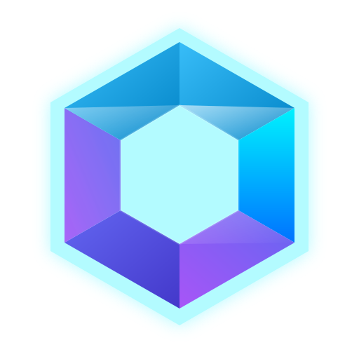
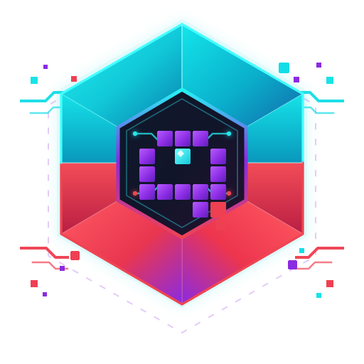
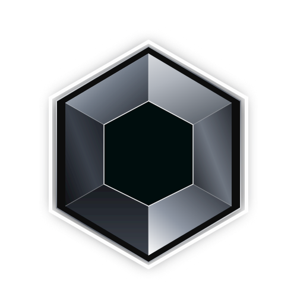

# Hi, I'm Amir Sohail 👋

### AI / ML Engineer · Agentic AI & GenAI Builder

*Building intelligent systems that go from notebook to production.*

---

## 🚀 Featured Project

<table>
<tr>
<td align="center" valign="middle" width="33%">
  
   <b>Quadra</b>
</td>
<!-- Quadra Pixel: add assets/quadra-pixel.svg, then uncomment this cell
<td align="center" valign="middle" width="33%">
  
   <b>Quadra Pixel</b>
</td>
-->
<td align="center" valign="middle" width="33%">
  
   <b>Quadra Engine</b>
</td>
</tr>
</table>

### Quadra

*A loan risk assessment platform with explainable predictions.*

[**View Project →**](https://quadra-studio.onrender.com)

I've been hosting Quadra for the past few months. It estimates an applicant's default risk and explains the reasoning behind each verdict, built with a FastAPI backend and a UI served from the same server.

---

## 🔭 About Me

| | |
|---|---|
| 🔭 **Working on** | Agentic AI systems, GenAI applications, and advanced ML/DL models |
| 👯 **Collaborating on** | Open-source Generative AI, LangChain / LangGraph projects, and MLOps |
| 🌱 **Learning** | Fine-tuning LLMs and advanced Vector DB architectures |
| 🤝 **Seeking help with** | Advanced cloud deployment (AWS, Kubernetes) and CI/CD pipelines |
| 💬 **Ask me about** | Python, Scikit-learn, TensorFlow, AI Agents, Docker, Streamlit |

---

## 🎯 Focus Areas

- **Agentic AI**: multi-step AI agents and orchestration with LangChain / LangGraph
- **Generative AI**: LLM-powered applications and fine-tuning workflows
- **Machine Learning & Deep Learning**: end-to-end modelling, feature engineering, evaluation
- **MLOps**: containerisation, experiment tracking, CI/CD and cloud deployment
- **Explainable AI**: building models people can trust and audit (SHAP)

---

## 💻 Tech Stack

### 🛠️ Skills by role

#### 👨‍💻 Languages

#### 🧠 AI / ML / Data Science

#### 🤖 GenAI & Agentic AI

#### 🧰 Backend & Frameworks

#### ☁️ Cloud, DevOps & CI/CD

#### 🔀 Version Control

#### 🗄️ Databases

#### 🎮 Game Dev

---

## 📊 GitHub Stats

  

  

---

## 📈 Contribution Analytics

---

## 🐍 Contribution Activity

<picture>
  <source media="(prefers-color-scheme: dark)" srcset="https://raw.githubusercontent.com/amirsohail100/amirsohail100/output/github-snake-dark.svg" />
  <source media="(prefers-color-scheme: light)" srcset="https://raw.githubusercontent.com/amirsohail100/amirsohail100/output/github-snake.svg" />
  
</picture>

---

## 🤝 Let's Connect

  

<table>
<tr>
<td width="50%" valign="top">

**🤝 Open to collaborate on**
- Open-source Generative AI
- LangChain / LangGraph agentic projects
- MLOps pipelines and deployment

</td>
<td width="50%" valign="top">

**🙋 Where I'd love input**
- Cloud deployment (AWS, Kubernetes)
- CI/CD pipelines
- Fine-tuning LLMs and vector DB architectures

</td>
</tr>
</table>

 

 

  

Always happy to talk about projects, ideas and open-source contributions.

  

<!-- Proudly created with GPRM ( https://gprm.itsvg.in ) -->
